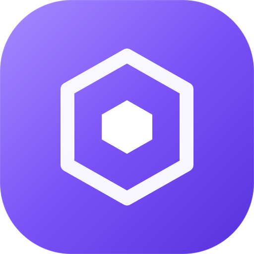

<p align="center">
  
</p>

<h1 align="center">Loadstone</h1>

<p align="center">
  A modern, self-hosted panel for running Minecraft servers in Docker — on one machine or many.
</p>

<p align="center">
  <a href="https://github.com/lisaaqt/loadstone/actions/workflows/ci.yml"></a>
  <a href="https://hub.docker.com/r/lisaaqt/loadstone-panel"></a>
  <a href="LICENSE"></a>
</p>

---

Loadstone gives you a clean web panel to create, run and manage Minecraft servers. Every server runs in its own Docker container, and a small agent on each host does the actual work — so you can start with one machine and add more later.

## ✨ Features

- **Every server type** — Vanilla, Paper, Purpur, Spigot, Folia, Fabric, Quilt, Forge, NeoForge, plus Velocity, BungeeCord and Waterfall proxies, or any custom Docker image
- **Live console** with colours, command history and log download
- **File manager** with a built-in code editor, uploads, zip/unzip
- **Backups** — manual or scheduled, to the node's disk, S3-compatible storage or SFTP
- **Plugins & mods** from Modrinth and Hangar in one click
- **Players** — whitelist, operators, bans and kicks
- **Proxy networks** — add servers to a Velocity/BungeeCord proxy with a click, including fallbacks and forwarding setup
- **Databases** — give servers their own MySQL, MariaDB or MongoDB database
- **Schedules** — restarts, backups and commands on a cron schedule
- **Team access** — invite members to a server, optional self-service server creation
- **Multiple nodes** with resource limits, health checks and usage charts
- **Email** notifications with customizable templates
- **Light and dark mode**, update notifications and a security-hardened setup (non-root containers, encrypted secrets, audit log)

## 🚀 Quick start

You need a Linux server with [Docker](https://docs.docker.com/engine/install/) installed.

**1. Get the compose file**

```bash
mkdir loadstone && cd loadstone
curl -fsSLO https://raw.githubusercontent.com/lisaaqt/loadstone/main/registry-deploy/docker-compose.yml
curl -fsSL https://raw.githubusercontent.com/lisaaqt/loadstone/main/registry-deploy/.env.example -o .env
```

**2. Configure it**

Open `.env` and set at least these values:

```env
APP_URL=http://your-server-ip:3000
APP_SECRET=<random, e.g. openssl rand -hex 32>
POSTGRES_PASSWORD=<random, e.g. openssl rand -hex 32>
```

**3. Start it**

```bash
docker compose up -d
```

Open `APP_URL` in your browser and create the administrator account.

**4. Add a node** (the machine your Minecraft servers run on)

In the panel, go to **Nodes → Add node**. Loadstone shows a `docker run` command for the agent — run it on that machine (it can be the same server). Then create your first Minecraft server under **Servers → New server**.

> 💡 Prefer one file without `.env`? Use [`docker-compose.all-in-one.yml`](registry-deploy/docker-compose.all-in-one.yml) — it also works as a Portainer or Dockge stack.

### Updating

```bash
docker compose pull && docker compose up -d
```

Admins see a notice in the panel when a new version is available. Remember to update the agent on your nodes as well.

## 🧩 How it works

```
Browser ──▶ Panel (web UI + API) ──▶ Agent on each node ──▶ Minecraft containers
               │        │
          PostgreSQL   Redis ◀── Worker (installs, backups, schedules)
```

| Image | What it does |
| --- | --- |
| [`lisaaqt/loadstone-panel`](https://hub.docker.com/r/lisaaqt/loadstone-panel) | Web interface, API and live console |
| [`lisaaqt/loadstone-worker`](https://hub.docker.com/r/lisaaqt/loadstone-worker) | Background jobs: installs, backups, schedules, node health |
| [`lisaaqt/loadstone-agent`](https://hub.docker.com/r/lisaaqt/loadstone-agent) | Runs on every node and manages the Minecraft containers |

The browser never talks to an agent directly: every action is checked by the panel first and then sent to the agent with a per-node token.

## 📚 Documentation

- [Configuration](docs/configuration.md) — all environment variables for the panel and the agent
- [Development](docs/development.md) — run Loadstone locally and contribute
- [Building from source on a server](deploy/DEPLOY.md) — the `update.sh` bundle deployment

## 🤝 Contributing

Contributions are welcome! Please read [CONTRIBUTING.md](CONTRIBUTING.md) before opening a pull request. Found a security issue? See [SECURITY.md](SECURITY.md).

## 📄 License

Loadstone is free software under the [GNU Affero General Public License v3.0](LICENSE). If you run a modified version as a service for others, you must publish your changes under the same license.

Loadstone is not affiliated with Mojang or Microsoft. Minecraft is a trademark of Mojang Synergies AB.
