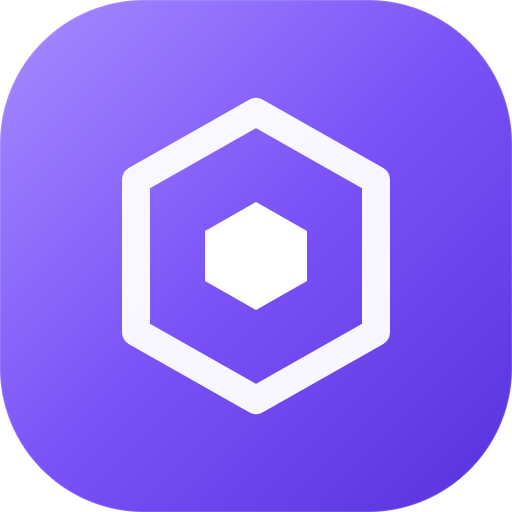

<p align="center"></p>

# Loadstone Agent

The node agent of **[Loadstone](https://github.com/lisaaqt/loadstone)**, a modern self-hosted panel for running Minecraft servers in Docker.

Run it on every machine that should host Minecraft servers. It talks to the local Docker engine and manages server containers, files, backups and the console on behalf of the [panel](https://hub.docker.com/r/lisaaqt/loadstone-panel).

## Usage

1. In the panel, go to **Nodes → Add node** and copy the generated command.
2. Run it on the node. It looks like this:

```bash
docker run -d --name loadstone-agent --restart unless-stopped \
  --security-opt no-new-privileges:true --read-only --tmpfs /tmp \
  --cap-drop ALL --cap-add CHOWN --cap-add DAC_OVERRIDE --cap-add FOWNER --cap-add SETUID --cap-add SETGID \
  -p 8080:8080 \
  -v /var/run/docker.sock:/var/run/docker.sock \
  -v /var/lib/loadstone:/var/lib/loadstone \
  -e LOADSTONE_TOKEN=<token from the panel> \
  -e LOADSTONE_DATA_DIR=/var/lib/loadstone \
  lisaaqt/loadstone-agent:latest
```

> The data directory must be mounted at the **same path** on the host and in the container, because the agent creates bind mounts for the server containers.

## Environment variables

| Variable | Default | Description |
| --- | --- | --- |
| `LOADSTONE_TOKEN` | required | Token generated by the panel |
| `LOADSTONE_DATA_DIR` | `/var/lib/loadstone` | Server files, local backups and metadata |
| `LOADSTONE_PORT` | `8080` | Listen port |
| `LOADSTONE_TLS_CERT` / `LOADSTONE_TLS_KEY` | — | Serve HTTPS/WSS directly |
| `LOADSTONE_PREPULL` | `recommended` | Server images downloaded in the background (`recommended`, `all`, `none` or a list) |

All options: [configuration docs](https://github.com/lisaaqt/loadstone/blob/main/docs/configuration.md).

## Security

The agent drops to an unprivileged user (UID 1000) after start-up when the Docker socket allows group access, and Minecraft servers run as UID 1000 without Linux capabilities. Access to the Docker socket is still equivalent to root on the host, so **only let the panel reach the agent's port** (firewall, private network or VPN).

## Tags

`latest` (newest release) and `x.y.z` for specific releases · `linux/amd64`. Keep the agent on the same version as the panel — the panel warns when a node runs an older agent.

## License

[AGPL-3.0](https://github.com/lisaaqt/loadstone/blob/main/LICENSE) · Source: [github.com/lisaaqt/loadstone](https://github.com/lisaaqt/loadstone)
