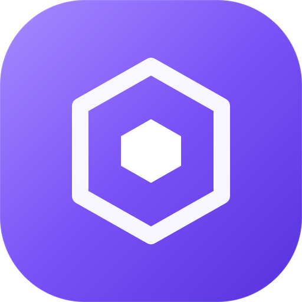

<p align="center"></p>

# Loadstone Panel

The web interface and API of **[Loadstone](https://github.com/lisaaqt/loadstone)**, a modern self-hosted panel for running Minecraft servers in Docker.

Use it together with [`lisaaqt/loadstone-worker`](https://hub.docker.com/r/lisaaqt/loadstone-worker) (background jobs) and [`lisaaqt/loadstone-agent`](https://hub.docker.com/r/lisaaqt/loadstone-agent) (runs on each node).

## Features

Paper, Purpur, Fabric, Forge, NeoForge, Velocity, BungeeCord and more · live console · file manager with code editor · backups to disk, S3 or SFTP · Modrinth/Hangar plugins · players · proxy networks · MySQL/MariaDB/MongoDB databases · schedules · team access · multiple nodes · email notifications · light and dark mode.

## Quick start

```bash
mkdir loadstone && cd loadstone
curl -fsSLO https://raw.githubusercontent.com/lisaaqt/loadstone/main/registry-deploy/docker-compose.yml
curl -fsSL https://raw.githubusercontent.com/lisaaqt/loadstone/main/registry-deploy/.env.example -o .env
# set APP_URL, APP_SECRET and POSTGRES_PASSWORD in .env
docker compose up -d
```

Open `APP_URL`, create the admin account, then add a node under **Nodes → Add node**.

## Tags

| Tag | Description |
| --- | --- |
| `latest` | Newest release |
| `x.y.z` (e.g. `0.2.4`) | A specific release; pin with `LOADSTONE_VERSION` |

Images are built for `linux/amd64`.

## Main environment variables

| Variable | Description |
| --- | --- |
| `DATABASE_URL` | PostgreSQL connection string |
| `REDIS_URL` | Redis connection string |
| `APP_URL` | Public URL of the panel |
| `APP_SECRET` | 32+ random characters, never change after the first start |
| `MIGRATE_ON_START` | `true` (default) applies database migrations on start |

All options: [configuration docs](https://github.com/lisaaqt/loadstone/blob/main/docs/configuration.md).

The container listens on port `3000`, runs as an unprivileged user and works with a read-only root filesystem.

## License

[AGPL-3.0](https://github.com/lisaaqt/loadstone/blob/main/LICENSE) · Source: [github.com/lisaaqt/loadstone](https://github.com/lisaaqt/loadstone)
